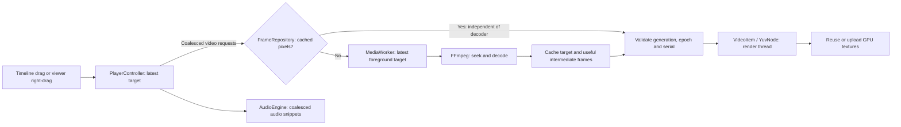

# Trie FrameViewer: caching and scrubbing

Implementation summary checked against v1.4.0 source on 2026-10-27.
The current design uses bounded decoded-frame caching, background prefetch, and
coalesced seek requests. It does not preload every video into a compressed,
whole-clip RAM or VRAM cache.

## 1. Data flow and ownership



- **GUI thread:** QML gestures, playback state, request scheduling, and audio output.
- **Video worker:** one decoder and cache writes. FrameRepository protects shared
  metadata; GUI cache hits do not wait for FFmpeg. Pixels stay immutable.
- **Audio decode worker:** separately prepares PCM audio so it does not occupy the
  video seek/prefetch worker.
- **Render thread:** uploads textures, manages the YUV texture cache, and draws.

`VideoFrame` shares immutable, owned pixel data between these components. Passing
a frame between threads does not require another full pixel copy. An initial
copy from the decoder's buffers gives the cache independent ownership.

## 2. The three caches

| Cache | Default budget | Contents | Purpose |
|---|---:|---|---|
| Video RAM | 512 MiB | Decoded YUV420 planes, or RGBA8 fallback frames | Avoid decoding a retained frame again |
| GPU textures | 64 MiB | Y/U/V textures for recently displayed YUV frames | Avoid uploading the same retained frame again |
| Audio RAM | 64 MiB | Decoded 48 kHz, stereo, signed 16-bit PCM | Playback and short scrub previews |

These are separate budgets, not a cap on total process RAM or total VRAM.
FFmpeg buffers, the current presentation frame, in-flight work, Qt/QML, temporary
conversions, and graphics-driver allocations add memory beyond them. Caches are
transient; saving a `.tfv` project saves review metadata, not cached pixels/audio.

### Compact video storage

Common 8-bit YUV420P, YUVJ420P, and NV12 video is copied into tightly packed Y/U/V
planes. NV12's interleaved chroma is separated into U and V. Color-matrix and
full/limited-range metadata travel with the frame. Other video formats and image
sequences use an RGBA8 representation.

Frames retain their decoded source resolution. Pan, zoom, rotation, and flipping
are display transforms; they do not create separate cached frame versions.

For even-sized frames:

```text
YUV420 bytes/frame = width × height × 1.5
RGBA8 bytes/frame  = width × height × 4
```

YUV420 therefore uses 62.5% fewer pixel bytes than RGBA8. For odd dimensions, the
exact planar size is `width × height + 2 × ceil(width/2) × ceil(height/2)`.

At 1280 × 720, one YUV420 frame is about 1.32 MiB. A 512 MiB cache holds about
388 such frames. A 271-frame clip needs about 357 MiB and can become fully cached;
4,000 frames need about 5.15 GiB and cannot all fit in that budget. These are pixel
storage calculations, not total application-memory measurements.

### RAM eviction

`FrameCache` combines a frame-index map with a least-recently-used (LRU) list.
Reads and inserts move a frame to the recently used end. Under budget pressure:

1. Evict the oldest frame outside the preferred playhead window, avoiding the
   current anchor when possible.
2. If necessary, evict older frames inside the window too.
3. A single frame larger than the budget is not retained in this cache.

Moving the playhead changes eviction priority; it does not immediately discard
previously visited regions. Small clips can fill completely in the background.
Opening another source clears the RAM cache.

FrameRepository invalidates old-source lookups immediately, then replaces and
destroys the old cache on the worker. Evicted pixel references are released after
unlocking the repository. FFmpeg calls and GPU work never hold this lock. Cache
content revisions avoid rebuilding unchanged coverage metadata.

### GPU texture reuse

The YUV render path uses a separate LRU keyed by each `VideoFrame`'s unique
identity. Reusing that same frame reuses its textures. New textures upload the
planes, release their temporary upload-byte references, and use a shader for
YUV-to-RGB conversion. The shader supports BT.601, BT.709, and BT.2020 matrices
with full/limited range.

When a new frame needs storage, a compatible evicted texture set is recycled
within the same GPU budget. There is no separate unbounded pool. Qt/QRhi orders
the new upload after earlier draws; the old frame key is removed before reuse.
Submitting the same immutable frame identity again skips a redundant item update.
Geometry, source, format and cache-budget updates still take effect normally.

The current YUV frame's textures remain resident even with a zero GPU-cache
budget. Budget accounting counts plane pixels, not all driver allocations.
The RGBA/software fallback uses a different display path without this multi-frame
YUV texture LRU.

The video worker does not look up missing RAM frames in VRAM. If a frame was
evicted from RAM and is decoded again, its new identity does not reuse the old
identity's GPU-cache entry.

## 3. Opening media and background prefetch

Opening a source resets the previous transport/cache state. The worker opens the
decoder, decodes frame zero, publishes it, starts separate audio decoding, and
plans a prefetch window using the first frame's byte size:

```text
capacity = clamp(floor(RAM budget / frame bytes), 1, clip frame count)
```

The window follows the latest requested frame and direction. Away from clip
boundaries, forward movement allocates roughly one quarter behind the anchor and
three quarters ahead; reverse movement swaps that bias.

- **Forward:** fill after the anchor first, then the earlier part of the window.
- **Reverse:** fill the earlier part first, then the later part.
- Both passes decode in **ascending frame order**, including reverse lookbehind,
  to avoid repeatedly seeking backward through the same compressed-video group.
- Already cached candidates are skipped. Background decoding retains useful
  intermediate frames inside the current window. Interactive foreground seeks
  materialize only the requested frame, avoiding speculative GPU downloads and
  pixel copies before presenting it. Reverse playback retains useful lookbehind
  intermediates; forward playback continues decoding toward its clock target.
- Foreground misses take priority. Playback and fine preview moves (up to four
  frames by default) allow immediate prefetch; large jumps and exact paused seeks
  retain the 80 ms quiet interval. Nearby cache hits update the plan without
  repeatedly cancelling useful work. Misses, reversals and distant hits supersede it.

During active playback the planner also respects the Start/End range. Near a
loop boundary it reserves up to one quarter of its frame capacity at the opposite
end, subtracting that reserve from the main window rather than adding memory.
Paused review can prefetch across the full clip. Timeline cache marks represent contiguous **RAM-cached** frame
ranges and appear only while Debug Mode is enabled; they do not indicate GPU
residency. Hiding these marks does not disable caching. Coverage updates are generally
throttled to about 100 ms, with immediate updates at some state transitions.

## 4. Scrubbing input and scheduling

### Timeline and viewer gestures

Timeline clicks/drags map horizontal position proportionally across the entire
clip, round to a frame, and clamp to valid bounds. Dragging through a bookmark
uses the same scrub path. Timeline seeks preserve the transport state: playing
continues in the same direction and at the same speed; paused remains paused.

Right-dragging in the viewer starts from the frame and mouse position at press:

```text
pixelsPerFrame = baseSensitivity × (1 + abs(verticalDistance) / 80)
targetFrame = originFrame + round(horizontalDistance / pixelsPerFrame)
```

The default base is 3 pixels/frame, or 12 while holding Shift. Moving vertically
away from the press point increases precision. The calculation remains relative
to the original press position. Viewer right-dragging pauses playback; middle-drag pans.

### Latest target wins

`PlayerController.seekTimeline(frame)` preserves transport state, while
`seek(frame, true)` uses the paused-scrub policy for viewer right-drags and stepping.
Both update the selected frame number immediately and record the latest target.
A single-shot 16 ms timer batches drag requests.
New mouse events update the target without restarting an already running timer,
so this does not wait for the user to stop moving before issuing work.

On a timer tick, `flushScrub()` submits the latest target within one drag-preview
session. New batches share the session epoch, so useful in-flight foreground
decoding can finish instead of repeatedly seeking again. Completed session
previews may be shown while the input cursor remains at the latest selected
frame. `presentedFrame()` identifies the actual decoded image for diagnostics.

Mouse release calls `finishScrub()` to end the preview session and issue an exact
target request in a new epoch. A 100 ms input quiet period also finalizes the
target, supporting callers that do not send an explicit release. Old session
results cannot replace this final frame. Playing/paused state, speed, and
direction are preserved. While timeline input is active, the playing flag stays
set but playback ticks and continuous audio wait; finalization rebases and resumes
the clocks. Paused scrub audio follows delivered previews. The frame number can
update before its pixels arrive because decoding and presentation are asynchronous.

`MediaWorker` keeps one pending target, overwriting it with newer requests instead
of queuing every intermediate mouse position. It checks RAM first; a miss invokes
FFmpeg for the requested pixels. Hits return shared pixels independently of any
in-flight decode and still update the worker's latest prefetch anchor. Cache
warming uses the adaptive background policy described above.
No synthetic in-between frames are generated.

## 5. Seeking compressed video and rejecting stale results

The decoder can continue forward without flushing for jumps of up to 256 frames
when its state permits. Backward jumps, larger forward jumps, decoder draining,
or a previous cancelled decode require a seek/flush. It seeks backward using
FFmpeg, then decodes forward from the seek point toward the target. A long GOP
(the keyframe/dependent-frame group) can make a cache miss expensive.

Frame indices are derived from timestamps and nominal FPS. Final-target requests
are exact requests in this indexing model; the player does not yet maintain a
complete ordinal/timestamp index for arbitrary variable-frame-rate video.

Three kinds of identifiers prevent obsolete work from taking over the viewer:

| Identifier | What it controls |
|---|---|
| Source generation/revision | Discard results and cancel work belonging to an older source |
| Transport epoch | Invalidate earlier seeks or playback sessions when transport changes |
| Request revision | Supersede the latest pending target |
| Speculation revision | Cancel obsolete prefetch on misses, reversals, or distant hits |
| Request serial | Reject an older delivery after a newer cached frame has been accepted |

Outside active drag previews, a paused controller accepts decoded results only
for the latest exact target and valid source/epoch. During playback, requests share an epoch so completed
frames may still advance in the playback direction toward the latest clock
target. Cancelling on every playback tick would otherwise starve presentation.
After a cancelled decode, the decoder forces a fresh seek because the demuxer may
have advanced past its last successfully returned frame.

Normal playback uses the same worker/cache. A 4 ms controller timer computes the
desired frame from elapsed time, FPS, direction, and speed; forward playback uses
the active audio clock when available. The timer is a scheduling cadence, not a
guarantee of one new displayed frame every 4 ms.

## 6. Audio scrubbing

Audio is decoded from the beginning into a bounded PCM buffer. Each finalized
scrub request schedules a 70 ms preview near the selected frame, adjusted by the
project's audio offset. `AudioEngine` coalesces these requests over 20 ms and uses
the latest position. Snippets play forward at normal speed even during backward
scrubbing, with short fades to reduce clicks. Continuous reverse playback is
silent.

Stopping discards the `QAudioSink`; restarting creates a fresh sink. This prevents
stale Windows audio buffers from breaking repeated seek/play/scrub cycles.
Volume changes update PCM gain with a ramp of up to 5 ms instead of calling native
device-volume setters on every slider movement. Continuous playback keeps its sink
and audio clock running while muted, so unmuting does not restart playback. Silent
scrub snippets skip opening a device. Volume notifications are isolated from cache,
decoder, menu, and shortcut updates; settings saves wait for 250 ms of quiet input.
The PCM cache is not a sliding window: beyond its cached beginning, audio is
unavailable. At the default format, 64 MiB holds roughly 5 minutes 50 seconds.

## 7. Hardware decode and current limits

- Auto mode attempts D3D11VA for supported video with at least 2,073,600 pixels
  (1920 × 1080). Smaller clips use software decoding; video defaults to two decoder
  threads. Software/forced-hardware options are available, applied when media opens.
- Hardware setup/initial-frame failure can fall back to software. Hardware frames
  are downloaded into CPU memory and later uploaded for display. This is not a
  zero-copy GPU pipeline, and higher VRAM use does not mean the entire clip is cached.
- Fast scrubbing over uncached regions can still stutter because keyframe seeking,
  decoding, GPU transfers, and uploads take time. Coalescing reduces wasted work;
  it cannot eliminate that work or make a large clip fit in a small cache.
- Cancellation is cooperative between decoder operations. A blocking FFmpeg file
  open/read is not guaranteed to stop immediately.
- Full-clip compressed/disk caching, proxy-resolution caching, direct GPU sharing,
  and a sliding audio cache are not implemented.
- Audio sink setup/stop still occurs on the GUI thread. The new trace captured a
  355 ms setup spike in one audible cached-scrub run; video cache hits do not remove
  this separate source of stalls.
- Exact VFR indexing and HDR/OCIO review workflows remain outside the current design.

## 8. Settings and code map

### Live memory display

Preferences → Debug Mode enables a small overlay in the viewer. It refreshes every
500 ms (also while playback is paused) and stops sampling completely when disabled.
The preference persists between launches and defaults to off.

- **RAM** is this process's resident working set, including shared pages. The tooltip
  also gives its private committed bytes; Task Manager's default private-working-set
  column can differ. This measures the app as a whole, not just the frame cache.
- **VRAM** sums this process's Windows GPU Process Memory `Dedicated Usage` instances.
  It includes textures, decoding surfaces, and other allocations attributed to the process.
- **Shared GPU** sums its `Shared Usage` instances: system memory used by the GPU.
  Integrated graphics use system RAM, and GPU counters can overlap RAM accounting.
- Instances are filtered by the exact `pid_<current PID>_` prefix and aggregated across
  adapters/physical GPU nodes because decoding and rendering can use different GPUs.
  The language-neutral PDH API translates English counter names on localized Windows.
- If counters fail, omit this process, or publish empty usage, a fallback queries the real Qt D3D11 adapter
  on the render thread after rendering, at most once per sampling interval. Its local
  and non-local counts cover this process on that rendering GPU (node 0). The tooltip
  identifies this narrower coverage. On integrated graphics, local memory is system RAM.
- Unsupported/failed GPU queries display **Unavailable**. Counters are separate views
  of memory accounting and must not be added together to estimate total physical usage.

The monitor uses Windows [GetProcessMemoryInfo](https://learn.microsoft.com/en-us/windows/win32/api/psapi/nf-psapi-getprocessmemoryinfo)
and [PDH counters](https://learn.microsoft.com/en-us/windows/win32/api/pdh/nf-pdh-pdhgetformattedcounterarrayw).
The renderer fallback uses [QueryVideoMemoryInfo](https://learn.microsoft.com/en-us/windows/win32/api/dxgi1_4/nf-dxgi1_4-idxgiadapter3-queryvideomemoryinfo).
It creates no GPU device and does not read back frames. Only the fallback requests
rendering at the sampling interval; disabling Debug Mode stops sampling and requests.

### Defaults and implementation

Defaults live in `config/defaults.json`; exposed preferences may override them.

| Setting | Default | Effect |
|---|---:|---|
| `cacheMiB` | 512 | Retained decoded-video pixel budget |
| `gpuCacheMiB` | 64 | YUV texture-cache pixel budget |
| `audioCacheMiB` | 64 | Decoded PCM budget |
| `scrubIntervalMs` | 16 | Controller drag-request batching interval |
| `scrubSettleMs` | 100 | Input quiet period before an exact final seek |
| `prefetchDelayMs` | 80 | Quiet period after large jumps / exact paused seeks |
| `fineScrubFrameThreshold` | 4 | Fine preview moves eligible for immediate prefetch |
| `prefetchRetargetFrames` | 8 | Nearby hits may continue speculative work |
| `scrubMilliseconds` | 70 | Audio preview duration |
| `scrubPixelsPerFrame` | 3 | Normal viewer right-drag sensitivity |
| `fineScrubPixelsPerFrame` | 12 | Shift-drag sensitivity |
| `decoderThreads` | 2 | Requested video decoder thread count |
| `decodeMode` | `auto` | Software/hardware selection policy |
| `hardwareMinimumPixels` | 2,073,600 | Auto-mode hardware threshold |
| `debugMode` | `false` | Enable the live memory overlay |
| `debugRefreshIntervalMs` | 500 | Memory sampling interval while enabled |

| Implementation | Responsibility |
|---|---|
| `src/ui/components/Timeline.qml`, `src/ui/views/Viewer.qml` | Pointer gestures and target calculation |
| `src/application/PlayerController.cpp` | Coalescing, clocks, epochs, presentation acceptance |
| `src/media/MediaWorker.cpp` | Latest-target scheduling, window planning, prefetch, cancellation |
| `src/media/FrameCache.h` | RAM lookup, LRU eviction, cached ranges |
| `src/media/FrameRepository.h` | Synchronized source-aware cache access and retirement |
| `src/media/PrefetchPlanner.h` | Budgeted directional, active-range and loop windows |
| `src/media/PlaybackTrace.cpp` | Optional bounded request and stage timing |
| `src/media/Decoder.cpp`, `src/media/VideoFrame.cpp` | FFmpeg seeking, compact pixels, hardware transfer |
| `src/presentation/VideoItem.cpp`, `src/presentation/YuvNode.cpp` | Texture reuse, upload, and display |
| `src/media/AudioEngine.cpp` | PCM output and scrub snippets |
| `src/platform/ResourceMonitor.cpp`, `src/presentation/WindowDiagnostics.cpp`, `src/ui/components/DebugOverlay.qml` | Process memory sampling, renderer fallback, and optional display |

Existing core, renderer, and audio tests cover cache eviction, cache refill,
random/cancelled seeks, source changes, GPU color conversion/reuse, and repeated
audio restarts. Optimization tests also cover a hit while foreground decode is
blocked, stale serial rejection, continuous-input prefetch and loop-window budgets.
Historical measurements are in `docs/performance.md`; v1.4.0 results and remaining
limitations are in `docs/performance-playback-optimization-2026-10-27.md`.

Set `TFV_TRACE_PATH` before launching to buffer a bounded diagnostic JSON trace.
Close normally to flush it, then use `scripts/analyze_playback_trace.py`. Tracing is
off by default; frameSwapped markers represent queued presentation, not monitor
scanout. Dropped events invalidate completeness claims.
