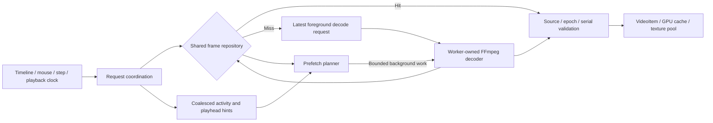

# FrameViewer playback and scrubbing improvement plan

Date: 2026-10-27. Status: first implementation milestone completed for v1.4.0;
later phases below remain planned.
Baseline: v1.3.0, commit `6d9edc7e48cd86beebc51641dc337c022cf8d5af`.
Evidence and qualifications are in the [updated comparison](D:/CodeProject/trie_frameviewer/docs/mpx-optimization-comparison-2026-10-26.md).

## Objective and scope

Implemented: bounded tracing, independent RAM hits with serial validation,
adaptive range/loop-aware prefetch, compatible GPU texture recycling, and duplicate
presentation suppression. Policy remains deterministic rather than cost-predictive.
The initial measurements show faster cached delivery, mixed cold-seek results,
and a remaining audio sink setup stall. See
[the measurement report](performance-playback-optimization-2026-10-27.md).
Proxy resolution, disk caching, native GPU frame sharing, exact VFR indexing,
and audio sink lifecycle changes are not part of this milestone.

Improve cached scrubbing, continuous playback, direction reversals, and CPU/GPU
resource efficiency while keeping explicit memory limits. Preserve exact released
frames, source/bookmark identity, playback state, and reliable audio. The first
optimization release will focus on measurement, independent cache hits, adaptive
prefetch, and rendering reuse. Reduced-resolution previews and GPU-native decoding
are subsequent, separately validated changes.

Retain the current compact shared-YUV design, source/transport invalidation, and
latest-pending-request behavior. Keep the existing default 512 MiB video RAM and
64 MiB GPU payload budgets for matched comparisons. These budgets do not describe
total process memory; report decoder, presented-frame, upload, and other retained
memory separately. Disk caching remains off in the initial work.

## Proposed component boundaries

| Component | Responsibility |
|---|---|
| `FrameRepository` | One synchronized store of immutable frames, lookup, retention, byte accounting, and source invalidation |
| `FrameRequest` / delivery rules | Request serial, source generation, transport epoch, target, interaction mode, and exact/preview requirements |
| `PrefetchPlanner` | Select the next useful cache extension/replacement from playhead, direction, active range, coverage, byte budget, and measured work cost |
| `MediaWorker` / `Decoder` | Execute foreground and speculative decode work; all FFmpeg state stays on its owning worker |
| `TexturePool` in presentation | Recycle compatible GPU texture sets within the same budget as retained GPU cache entries |
| `PlaybackTrace` | Optional bounded trace events and counters from input through presentation-queue submission |
| `PlayerController` | Coordinate commands/state and accept valid frame results; no FFmpeg, raw GPU objects, or allocation policy |
| QML | Input, settings, and lightweight metadata only; no pixel copies or scheduling loops |

These names describe proposed boundaries, not a requirement to introduce a class
for every small helper. Reuse existing types where doing so keeps ownership clear.

## Phase 0 — establish a usable baseline

Extend the existing engine and scrub benchmarks with per-request tracing and a
visible rendering workload. Use monotonic request serials rather than frame number
alone: repeated requests for the same frame must not overwrite each other's timing.

Record input time, request mode, queue wait, cache hit/miss, seek/preroll time,
decoded versus materialized frame counts, download/copy/upload bytes, audio-device
setup/reset time, texture
allocations, GUI acceptance, and frame queued for presentation. Link rendered
frame identity to the presentation marker. Already-displayed identical frames
should be acknowledged without requiring another draw.

Measure p50/p95/p99 latency, longest preview gap, delivered previews, target lag,
coalesced/cancelled requests, CPU time, and separately defined RAM/VRAM/shared-memory
readings. Latency percentiles alone can look good when most requests never deliver.

Use `frameSwapped` or the appropriate render marker without per-frame screenshots;
it marks a frame queued for presentation, not physical monitor scanout. Keep
readback-based pixel correctness tests separate. Test audio enabled and muted:
the existing muted engine traces can hide audio-device setup costs on the GUI path.

Trace collection must be optional and bounded, with buffered output outside the
hot path. No synchronous per-frame logging or GPU readback in normal playback.

Workloads:

- Cached adjacent steps and cached jumps while a cold decode is in flight.
- Cold random jumps, slow scrub, fast forward/backward scrub, and rapid reversals.
- Playback with no idle pauses between requests, looping a small range, and ping-pong.
- Release on an uncached frame, followed immediately by another seek or media change.
- 1080p and 4K SDR, long-GOP H.264/VP9/HEVC, image sequences, and dedicated VFR/10-bit fixtures.
- Representative user footage, such as `venom1.mkv`, if still available; record its
  fingerprint, codec, resolution, FPS, keyframe pattern, and selected decode backend.

Run builds/encodes and benchmarks sequentially. Use the same files, budgets,
window size, GPU, and audio state for baseline/new runs; distinguish warm and cold
file-cache conditions. Retain several repetitions and raw results. A comparison
with MPX must also record its binary identity and its audio/video cache semantics.

Deliverable: a reproducible baseline report showing which stage dominates each
workload. No speculative universal speedup claim.
The order below is the default implementation order; move a demonstrated dominant
cost, such as audio-on GUI blocking, earlier rather than optimizing an unrelated stage.

## Phase 1 — independent cache-hit delivery

Extract synchronized cache access from the decode loop into one `FrameRepository`.
Both the request path and worker refer to the same immutable frame storage;
introducing a duplicate GUI-side pixel cache would undermine the memory limit.

A request carries source generation, transport epoch, request serial, target
ordinal, and mode. The coordinator checks the repository before waiting for
decoding. A hit returns a shared handle through the normal delivery validation;
a miss replaces the latest pending foreground request.

Repository locks cover short metadata/container operations only. FFmpeg calls,
GPU work, and bulk frame destruction must occur outside those locks. Frame data
stays alive while a consumer holds its immutable handle, so cache eviction does
not invalidate a displayed/uploading frame.

Update result acceptance so an older in-flight decode cannot overwrite a newer
cache hit, even if both belong to one preview epoch. Preserve useful previews
while dragging and require the exact current target after release. Source changes
invalidate old results and old repository lookups immediately.

Cache hits still post coalesced playhead/activity hints to the planner. Otherwise,
moving entirely inside a warm cache could leave its ahead window stationary until
the first miss. Hints should not trigger a redundant decode of the hit.

Validation:

- A controlled test blocks the decoder and proves a cached target is delivered
  before that blocked decode is released. Avoid fragile millisecond assertions
  for this ordering guarantee.
- Older results cannot overwrite newer hits; release/source-switch races remain correct.
- Concurrent lookup, eviction, budget changes, and source reset preserve ownership
  and accounting. No codec work occurs on the GUI thread.
- Warm-cache input-to-presentation-queue p95 targets at most two refresh intervals
  on the test machine, approximately 33 ms at 60 Hz. This is an initial measured
  acceptance target, not a guarantee for cold codec seeks or all computers.

## Phase 2 — capacity-driven, interaction-aware prefetch

Replace the single universal 80 ms quiet condition with explicit operating modes:

| Mode | Priority and behavior |
|---|---|
| Playback | Maintain useful frames ahead of the displayed/requested position; warm loop start before wrap |
| Precise stepping / slow viewport scrub | Prioritize adjacent frames in both directions and sequential decoding reuse |
| Fast timeline drag / distant jump | Deliver useful previews and the newest target first; restrict speculative work |
| Idle | Extend useful cached boundaries while capacity and policy allow, then wait |

Planner decisions use coverage intervals, actual/estimated byte costs, active
Start/End, direction/velocity, known decode cost, and hysteresis against rapid
direction changes. Begin with conservative policies and compare the existing
approximately 75/25 directional preference with a more balanced policy. MPX's
0.5 parameter is evidence to test, not a ratio to copy universally.

Extend from a useful retained boundary instead of restarting an entire plan for
every request. Maintain adjacent continuity while retaining valuable visited
regions where the byte budget permits. Bookmarks can be a tie-breaking hint;
do not pin every bookmark or let them consume an unlimited cache.

Full capacity must allow replacement: choose an eligible lower-priority victim,
make room/reserve space for the next useful frame, and advance the retained window.
If nothing useful can be admitted, sleep on the existing condition variable.
Wake for request, playhead/range change, available capacity, source change, or shutdown.
Do not replace event-driven waiting with MPX's observed 10 ms polling interval.

Foreground work has priority. Use small, cooperative speculative batches with a
soft time/byte budget, and stop speculative admission when new input arrives.
Where safe, finish a frame boundary rather than repeatedly abandoning a partially
advanced decoder and forcing another GOP seek. Individual FFmpeg calls cannot be
assumed to obey a strict millisecond preemption deadline.

Keep the existing target-first materialization behavior for rapid cold seeks;
do not resume copying every preroll frame. Add GOP-aware cost decisions only when
there is trustworthy timing/keyframe information. Never interpret MPX's shipped
24-duration output gate as a fixed 24-frame prefetch prescription.

Validation:

- Continuous playback/drag can extend coverage without an 80 ms idle gap.
- A full cache advances with the playhead without breaching its retained payload limit.
- Active loops, ping-pong, and reversals retain useful boundary frames.
- Requested pixels arrive before speculative work; exact release remains correct.
- Compare CPU time, decoded/materialized counts, cancellation/reseek counts, target
  lag, and longest preview gap against baseline. Reject policies that trade better
  coverage for excessive fan/CPU activity or foreground stalls.

Phases 1 and 2 are separate changes: first make cache hits independent, then change
background policy. That keeps races and scheduling regressions diagnosable.

## Phase 3 — bounded GPU reuse and duplicate-update suppression

In `VideoItem`, skip identical frame submissions while preserving independent
updates for item geometry, color state, renderer changes, and cache budgets.
Likewise avoid dirtying geometry when its rectangle is unchanged. Emit cache
coverage notifications only when relevant coverage/accounting actually changes.

In the presentation layer, recycle compatible evicted texture sets rather than
creating three fresh plane textures for every new identity. Match dimensions,
plane layout, and pixel format. Keep recently useful frames in the existing GPU
LRU, and use evicted resources as the source of reusable storage.

The pool, resident GPU entries, and outstanding resources need one accounting
policy; a pool must not become a second unbounded VRAM cache. Reuse occurs on the
render thread with QRhi lifetime/ordering safeguards. Do not overwrite resources
still needed by an in-flight draw or add global GPU waits just to force reuse.

Keep R8 plane storage, disabled mipmaps, and current shader color conversion.
Handle resolution changes, scene-graph invalidation, budget zero, and renderer
fallback explicitly. Zero configured cache still needs a current display resource.

Validation: renderer color checks remain correct; stable-resolution traversal
substantially reduces texture creation after warmup; useful revisits avoid uploads;
pool/cache accounting remains within the declared policy; no stale textures appear
after seek, resize, media switch, or fullscreen transitions.

## Phase 4 — optional lower-resolution review previews

If 4K cache coverage/copy/upload costs remain dominant, add a separate review-quality
preference: source quality or a bounded preview resolution, initially 1080p. A 4K
8-bit YUV frame is about 11.87 MiB; a 1080p preview is 2.97 MiB, allowing roughly
four times as many preview frames in the same payload budget.

Use representation-aware keys: source identity, ordinal/PTS, preview dimensions,
and color format. Preview and exact representations share the CPU budget, rather
than each getting 512 MiB. Preserve original dimensions in source metadata and
track displayed representation quality separately.

During dragging, prioritize preview coverage. On release, retrieve the exact
selected source frame. Step/zoom workflows should have a clear source-quality
policy, and the UI should identify preview quality. Exports always use the source.
Bookmarks continue identifying source frames, not proxy frame numbers.

This reduces retained bytes and GPU upload work. It does not guarantee cheaper
compressed reference-frame decoding: some codecs still reconstruct full-resolution
reference pictures. Profile conversion cost too; a preview path is worthwhile only
if total responsiveness improves.

This setting is distinct from the existing Full HD export resolution and from
simply fitting the source image into a smaller viewport.

## Phase 5 — targeted follow-up work

Choose these from measured needs rather than treating them as mandatory prerequisites:

| Work | Trigger | Guardrails |
|---|---|---|
| PTS/duration/keyframe index (`MediaTimeline`) | VFR inaccuracies or poor seek-distance decisions | Asynchronous indexing; stable source ordinals and existing bookmark meaning; no naive nominal-FPS schema migration |
| Native NV12 and bounded CPU buffer reuse | UV splitting/allocation/copy costs are significant | Native Y + UV representation with supported texture formats; tested software fallback; never mutate pixels still shared by consumers |
| High-bit-depth/HDR handling | 10-bit inputs fall back to expensive RGBA or display incorrectly | Preserve color metadata and implement correct transfer/tone mapping; an 8-bit Bt.2020 matrix alone is insufficient |
| D3D11 decoder/renderer interoperability | Hardware download/upload dominates after earlier phases | Shared-device/adapter validation, bounded decoder surfaces, proper synchronization, and a reliable CPU fallback |
| Deferred frame retirement | Large-cache clears delay opening or changing media | Release outside repository locks; bounded retired bytes and measured time/byte batches; include retired/pinned frames in diagnostics |
| Sliding audio cache | Scrubbing/playback extends beyond the cached PCM prefix | Preserve audio-clock behavior and the tested Windows sink-restart workaround; verify seek/loop/replay/mute |
| Playback deadline scheduling | The 4 ms polling timer contributes meaningful idle CPU work | Schedule the next useful video frame while preserving audio as master clock; do not copy MPX's 40 ms event-service threshold |

GPU interop alone will not hold thousands of decoded 4K frames cheaply. Neither
MPX's higher VRAM readings nor its static reports prove a full-clip GPU cache.

## Disk proxy policy

Do not build a multi-gigabyte raw-frame disk cache. Only consider disk proxies if
repeated cold distant seeks remain a real problem after the preceding work.

Any proxy feature should be optional, seek-friendly, fingerprinted, and enforce a
hard configurable total quota, initially on the order of 256–512 MiB. Evict old
segments, report actual disk usage, and provide Clear Cache. Repeated opens cannot
silently grow the quota. A whole video is not guaranteed to fit.

Creation should be background/low-priority and should yield during review. A small
ordinary long-GOP MP4 is not necessarily an effective random-seek proxy. Test GOP
decode distance, quality, indexing, and generation cost alongside compressed size.

## Delivery and release gates

Use one Git branch under `codex/` and small reviewable commits, keeping the normal
build folder. Preserve a reproducible baseline/tag; do not create per-release
source folders or move existing release tags.

Suggested milestones:

1. Baseline trace and independent cache-hit path, with existing scheduling retained.
2. Adaptive prefetch, continuous-playback coverage, and loop-aware replacement.
3. Presentation deduplication and texture recycling.
4. An optimization release after milestones 1–3 meet their acceptance criteria.
5. Optional preview-quality release, followed by individually justified advanced work.

After each behavior change, run focused cache/request/scheduler/renderer tests and
the relevant existing core/audio tests. At release, run native UI smoke including
bookmarks, playing/paused timeline seeks, reverse/looping, volume, Cinema Mode,
Always on Top, and both MP4 export tools. Keep timing assertions in controlled
performance runs rather than flaky unit tests.

Publish only if representative workloads improve without breaking exactness,
audio, memory-accounting policy, or ordinary playback. Record improvements and
regressions separately for warm hits, cold seeks, 4K previews, and audio-on runs.
Produce the rebuilt app/installer, verify standalone dependencies, and update the
private release. Replace an installed executable only after checking its running
state and protecting any unsaved project.

This plan proposes no guaranteed MPX parity or universal cold-seek latency. The
first delivery is a more responsive bounded-cache system whose benefits can be
measured and whose components remain easy to change independently.
